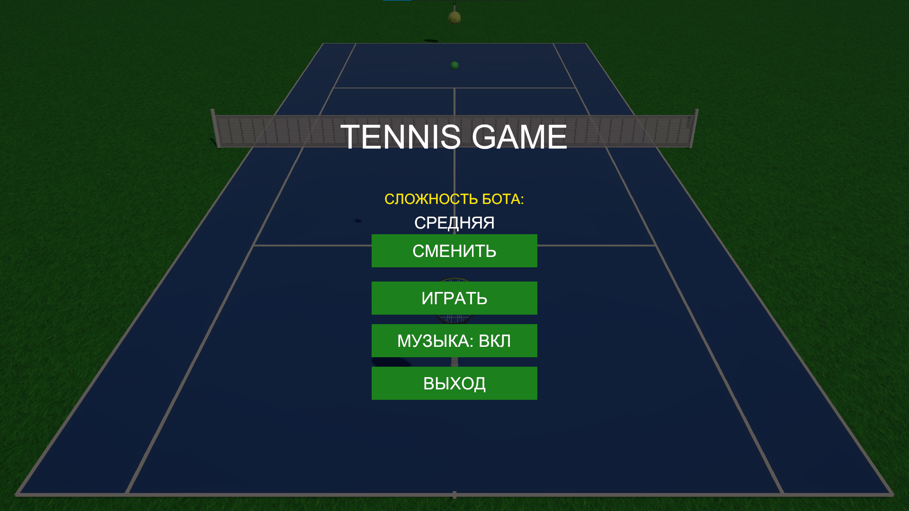
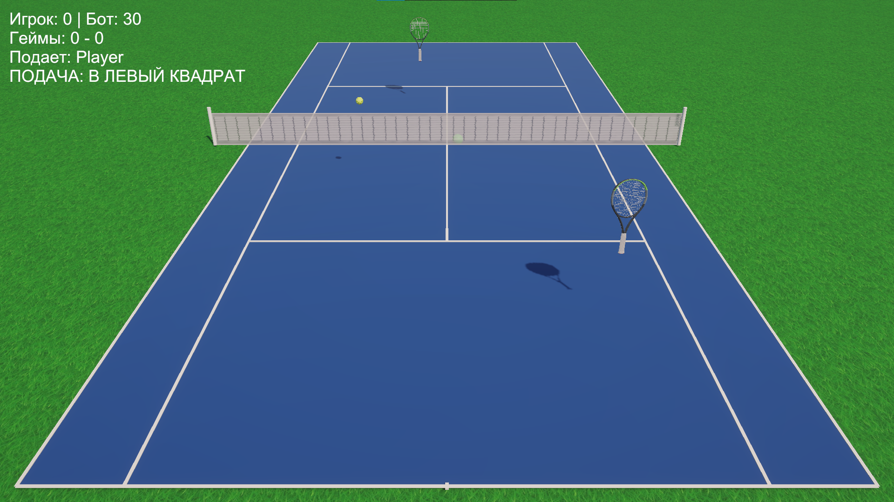

# 🎾 Tennis Game (Unity)

Твой личный теннисный корт на Unity! Умный ИИ-соперник, честный подсчет очков (15-30-40-Ad) и полноценные правила подачи. Подбирай сложность, отбивай низкие и высокие мячи — отличный способ проверить свою реакцию.

## 📸 Скриншоты

*Главное меню с выбором сложности и настройками звука*

*Игровой процесс*

## ✨ Особенности

* **Управление:** 
  * `WASD` — передвижение игрока.
  * `Мышь` — наведение прицела (AimTarget).
  * `Пробел` — удар (обычный).
  * `Пробел + E` — низкий (плоский) удар.
* **Правила тенниса:** Подсчет очков (15, 30, 40, Ad), смена подачи по геймам, диагональная подача в квадрат.
* **Умный ИИ (Бот):** Бот предугадывает траекторию мяча, бегает по всей своей половине и пытается бить в свободные углы. 
* **Сложность:** Три уровня (Легкий, Средний, Сложный), которые влияют на скорость, силу и точность бота.
* **Звук и музыка:** Фоновая музыка и звуки ударов/отскоков.

## 🛠️ Как запустить проект

### Вариант 1: Играть в готовую сборку (без Unity)
1. Перейди в раздел [Releases](https://github.com/staspykubsu/tennis-game/releases) (справа на странице).
2. Скачай последний архив (`.rar`).
3. Распакуй и запусти файл `Tennis.exe`.

### Вариант 2: Открыть исходный код в Unity
1. Скачай или клонируй репозиторий:
   `git clone https://github.com/staspykubsu/tennis-game.git`
2. Открой проект через Unity Hub (рекомендуется Unity 2022.3 или новее).
3. Открой сцену `Assets/Scenes/SampleScene.unity` и нажми Play.

## 🔧 Технологии
* Unity (URP)
* C#
* Математическая модель физики мяча (без использования Rigidbody для полета)

## 👤 Автор
Создано в рамках изучения Unity и геймдизайна.
GitHub: [staspykubsu](https://github.com/staspykubsu)
